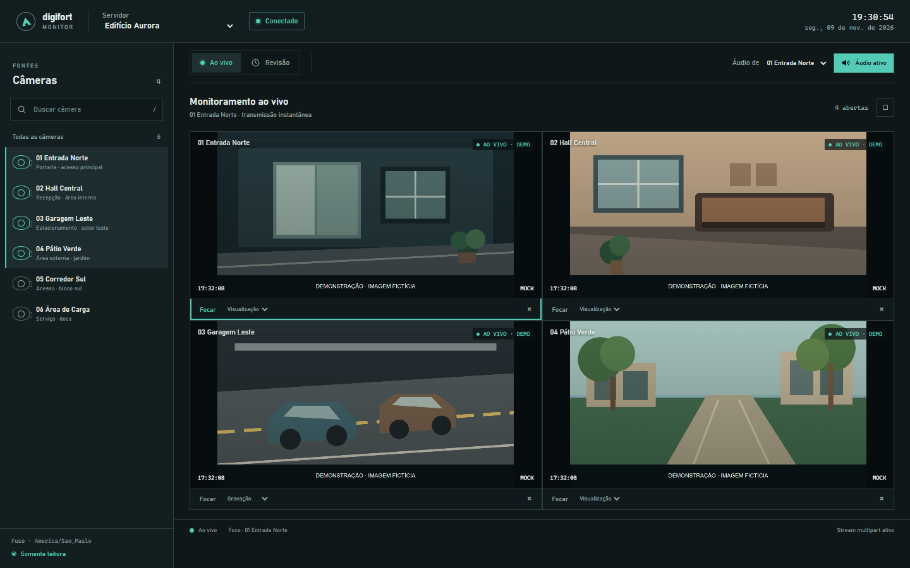

# Digifort Monitor



*Captura ilustrativa: câmeras, nomes e imagens são fictícios e não vêm de um servidor Digifort.*

Player local para monitorar câmeras Digifort ao vivo e revisar gravações.

## Funcionalidades

- Abra várias câmeras ao mesmo tempo, filtre a lista e escolha o perfil de transmissão de cada câmera.
- Veja vídeo H.264 e H.265/HEVC com decodificação WebCodecs. O navegador precisa aceitar o perfil de codec enviado pelo servidor.
- Ative o áudio após uma interação explícita, selecione a câmera de origem e ouça áudio ao vivo ou disponível na gravação. O player decodifica AAC, G.711 e G.726 quando esses formatos são enviados.
- Revise gravações por data e hora, acompanhe intervalos de vídeo e áudio na timeline e navegue por cliques na timeline ou nas miniaturas.
- Expanda uma câmera em tela cheia com duplo clique ou a tecla F; pressione Esc para voltar.
- A lista de câmeras pode ser rolada e a grade limita o tamanho dos tiles para manter os controles e a timeline acessíveis.

## Configurar um servidor

1. Copie `config/example.config` para `config/<servidor>.config`.
2. Preencha `name` com o rótulo amigável mostrado na lista; se omitido ou vazio, será usado o nome do arquivo. Preencha também `serverAddress`, `userAgent`, `username`, `password` e `timeZone`.
3. Edite `initialCameras` com nomes de câmera exatamente como o Digifort os retorna e o perfil `Visualization` ou `Recording`.
4. Mantenha os arquivos reais dentro de `config/`. O Git ignora essas configurações locais e preserva somente `example.config`.

O player mantém usuário, senha e dados de autenticação no processo local. Eles não são enviados à página nem escritos em logs. Não coloque credenciais reais no arquivo de exemplo.

Por padrão, `useBasicAuth` é `false` e o player usa autenticação segura por sessão. Para autenticação tradicional, defina `useBasicAuth: true`; o player envia `AuthUser` e `AuthPass` na query string. Credenciais em URLs podem ser registradas pelo servidor, proxy ou infraestrutura de rede.

## Executar

```powershell
npm start
```

Abra `http://127.0.0.1:4177`. O áudio só é solicitado depois de ativá-lo na interface.

Como alternativa, execute `Iniciar-Digifort.bat`: o servidor fica no terminal atual e o Chrome abre quando a porta responder, em uma janela de aplicativo sem barras de endereço/favoritos. O Chrome usa seu perfil dedicado e mantém as proteções de segurança web ativadas. Encerre o Node com `Ctrl+C` nesse terminal.

O terminal mostra a URL local na inicialização e registra erros de transporte/API. Requisições e respostas normais, incluindo cabeçalhos e prévias de corpo, não são impressas.

## Áudio

Escolha uma câmera aberta em **Áudio de** e ative o botão **Áudio**. O player envia a solicitação de áudio junto com a transmissão selecionada e entrega ao Web Audio os frames AAC, G.711 ou G.726 recebidos. Na revisão, usa o áudio multiplexado disponível em `Playback/GetMediaStream?Audio=TRUE`.

Se o servidor enviar áudio G.726, compile o módulo WebAssembly usando Docker Desktop ativo:

```powershell
npm run build:g726
```

O arquivo `.wasm` gerado fica em `public/wasm` e é reutilizado em execuções seguintes. Docker não é necessário para iniciar o player. O decoder G.726 é carregado sob demanda; a taxa vem do MIME do frame (`audio/G726-16/24/32/40`). O código usa packing LSB conforme RFC 3551 quando o stream não informa a ordem e identifica esse fallback no tile.

## Vídeo

O player decodifica H.264 e H.265/HEVC com WebCodecs. Para H.265, deriva a string de codec a partir do SPS, verifica o suporte do navegador à configuração recebida e aguarda VPS/SPS/PPS e um quadro de acesso aleatório antes de iniciar. A disponibilidade genérica do WebCodecs não garante suporte a todos os perfis HEVC.

## API e manual

A pasta [`api/`](api/) contém a especificação OpenAPI 3.0.3 da HTTP API 1.9.0, o manual de origem e instruções de importação e uso no JetBrains. A especificação cobre as operações e os parâmetros documentados no manual.

O player usa `GetCameras`, `GetMediaStream`, `Playback/GetMediaStream`, `GetTimelineData` e `Playback/GetSnapshot`. Não usa API de exportação/download, MJPEG como substituto do stream de mídia nem APIs que alterem configuração do servidor ou preferências do usuário.

## Falha conhecida

No teste atual, `/api/server` responde `200`, mas a chamada Node a `Cameras/GetCameras` falha com `FETCH_ERROR` antes de receber uma resposta HTTP. O usuário observou `200` ao abrir essa rota diretamente no navegador com autenticação tradicional. A causa ainda está sendo investigada; acompanhe a [issue de handoff](https://github.com/steffmartin/digifort/issues/1).

A chave opcional `initialMosaic` em `config/<servidor>.config` define o mosaico inicial. Use um dos IDs abaixo; o nome à direita é o exibido no seletor:

| ID | Grade |
| --- | --- |
| `auto` | Grade automática |
| `2x2` | 2 × 2 · 4 câmeras |
| `3x3-six` | 3 × 3 · 6 câmeras |
| `4x4-eight` | 4 × 4 · 8 câmeras |
| `3x3` | 3 × 3 · 9 câmeras |
| `4x4-ten` | 4 × 4 · 10 câmeras |
| `4x4-thirteen-a` | 4 × 4 · 13 câmeras A |
| `4x4-thirteen-b` | 4 × 4 · 13 câmeras B |
| `4x4-center` | 4 × 4 · 13 câmeras C |
| `4x4` | 4 × 4 · 16 câmeras |
| `5x5` | 5 × 5 · 25 câmeras |

Sem a chave, o player usa a grade automática. A escolha feita na interface dura apenas até a sessão terminar.

A visibilidade das informações sobrepostas, timeline e miniaturas e o tamanho das miniaturas são escolhas da sessão: cada página inicia com informações ocultas, timeline e miniaturas visíveis e tamanho médio. Timeline e miniaturas seguem a câmera em foco; painéis ocultos não fazem chamadas às APIs.
