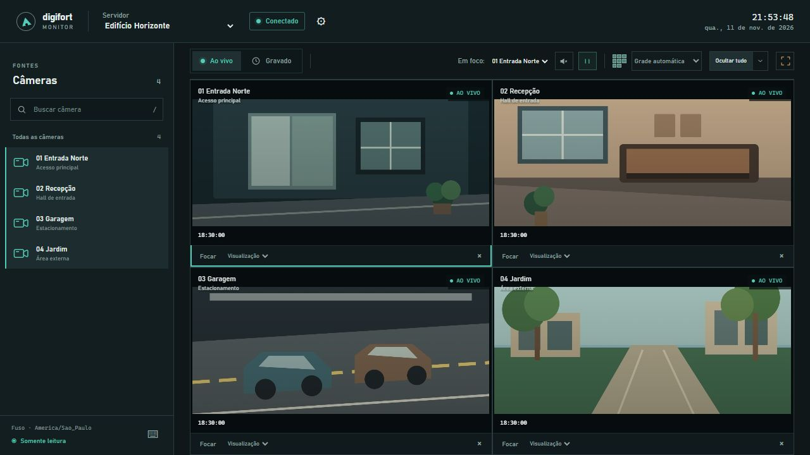

# Digifort Monitor



## Em poucas palavras

O Digifort Monitor é um cliente local não oficial para visualizar câmeras de segurança IP/CFTV do Digifort. Abra câmeras ao vivo em um mosaico, revise gravações pela timeline e salve imagens ou clipes no computador.

**Palavras-chave:** `Digifort` · `Digifort surveillance client` · `Digifort camera viewer` · `CCTV` · `monitoramento de câmeras` · `vigilância IP`

## Baixar e começar

O instalador x64 gerado pelo código atual inclui o Node.js e usa Google Chrome, Chromium compatível ou Microsoft Edge já instalado. Ele aceita Windows 10 e 11, mas o teste no Windows 10 ainda está pendente. Consulte as [notas de cada release](https://github.com/steffmartin/digifort/releases) para os requisitos do pacote publicado ou siga o [build do instalador](docs/DISTRIBUICAO.md#build-da-versão-100) para gerar o pacote localmente. Compare o SHA-256 do instalador com `SHA256SUMS.txt` antes de executar o arquivo baixado.

Durante a instalação, escolha importar um `.config`, preencher os dados de um servidor ou configurar depois. Abra **Digifort Monitor** no menu Iniciar e gerencie os servidores no diálogo de configurações. O [guia de uso](docs/USO.md) explica como conectar um servidor e usar o player.

## Recursos e funcionamento

- **Ao vivo**. Filtre a lista de câmeras, monte um mosaico e escolha o perfil de cada transmissão.
- **Revisão**. Consulte intervalos de vídeo e áudio gravados e navegue pela timeline e pelas miniaturas.
- **Áudio e vídeo**. Reproduza H.264, H.265/HEVC, AAC, G.711 e G.726 conforme o suporte do navegador e o perfil enviado pelo servidor.
- **Captura local**. Salve PNGs sem sobreposições e grave os quadros reproduzidos pelo navegador em um formato compatível com `MediaRecorder`.
- **Configuração e teclado**. Gerencie servidores no aplicativo e consulte os atalhos no rodapé da lista de câmeras.

O servidor local Node.js atende a interface e encaminha chamadas de leitura à HTTP API do Digifort. A decodificação ocorre no navegador. O [guia de continuidade](docs/CONTINUIDADE.md) descreve a arquitetura e os limites da validação.

## Desenvolvimento

Use Node.js 20 ou superior e um navegador compatível. A partir da raiz do repositório:

```powershell
npm start
```

Abra `http://127.0.0.1:4177`. No Windows, também é possível executar [Iniciar-Digifort.bat](Iniciar-Digifort.bat) para abrir em modo aplicativo ou `Iniciar-Digifort.bat --diagnostico` para acompanhar os logs. Use o [modelo de configuração](config/example.config) para preparar um arquivo local em `config/`.

Para verificar a sintaxe do servidor e da interface:

```powershell
node --check server.mjs
node --check public/app.js
```

## Organização e documentação

| Caminho | Conteúdo |
| --- | --- |
| [`server.mjs`](server.mjs) | Servidor local, configurações, autenticação e integração com o Digifort |
| [`public/`](public/) | Interface, player e módulo WASM usado em execução |
| [`config/example.config`](config/example.config) | Modelo de configuração por servidor |
| [`installer/`](installer/) e [`scripts/`](scripts/) | Inicializador, instalador e ferramentas de build |
| [`wasm/g726/`](wasm/g726/) | Código e instruções de build do decodificador G.726 |
| [`docs/`](docs/) | Guias, notas de versão, histórico e referência da API |

- [Uso](docs/USO.md) — instalação, configuração, monitoramento e revisão.
- [Distribuição](docs/DISTRIBUICAO.md) — build, verificação e manutenção do pacote Windows.
- [Continuidade](docs/CONTINUIDADE.md) — arquitetura, validação e trabalho de manutenção.
- [Guia de UI](docs/UI.md) — componentes, estados e interações a preservar.
- [Notas de versão](docs/NOTAS-DE-VERSAO.md) — conteúdo e validação da versão.
- [Referência HTTP API](docs/api/README.md) — OpenAPI, manual de origem e uso no JetBrains.
- [Orientações para agentes](AGENTS.md) — regras do repositório e índice de leitura.
- [Issues do GitHub](https://github.com/steffmartin/digifort/issues) — bugs e melhorias.
